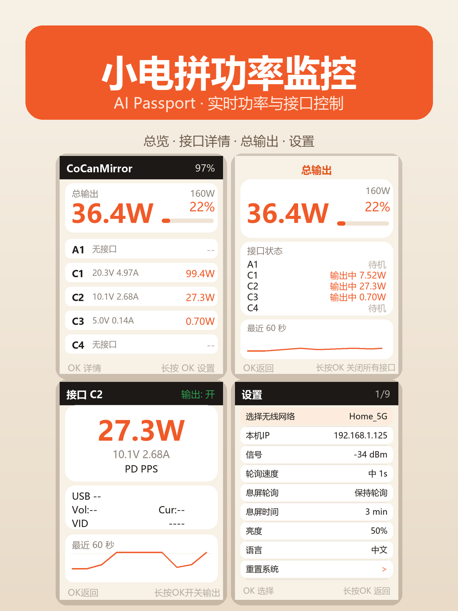

# CoCanMirror · 小电拼功率监控（AI Passport）

把 FoloToy AI Passport 变成小电拼（CoCan）充电器的随身功率仪表。



## 能做什么

- **总览**：总输出功率、160W 占用比例、5 个接口的实时电压 / 电流 / 功率
- **接口详情**：功率、电压电流、快充协议、最近 60 秒曲线
- **总输出详情**：总功率与占比、各接口状态（OFF / 待机 / 输出中）、60 秒曲线
- **接口开关**：详情页长按 OK 切换单口；总输出页长按 OK 按当前状态开启 / 关闭全部接口
- **设备端配网**：首次开机连 `AIPassport-XXXX` 热点，手机自动弹出配置页，列表选择 Wi-Fi、填写小电拼 MCP 地址
- **设置**：轮询速度 0.5 / 1 / 3 秒、息屏轮询、息屏时间、亮度、中英文

## 下载与安装

固件在 [Releases](https://github.com/Kiiiiro/CoCanMirror-passport/releases/tag/v2.6.2) 下载：

```bash
esptool --chip esp32c3 -p <PORT> -b 460800 write_flash 0x0 FoloToy-AI-Passport-2.6.2-public.bin
```

SHA256：`0f86477c912598666a00ec757c1adfb711768083a901fba1ebe4e7a6c4498e70`

## 从源码构建

需要 ESP-IDF 5.5.3：

```bash
idf.py set-target esp32c3
idf.py build
```

## 说明

- 仅支持云端 MCP，需要联网和有效 MCP 地址
- 线缆芯片详情（USB 速率 / 线材规格 / VID）暂不显示：服务端单次返回约 12KB，超出设备缓冲
- 云端连接为加密但不校验证书，建议连接可信 Wi-Fi
- 更多说明见 [docs/cocan/README.md](docs/cocan/README.md)

## 致谢

基于 [FoloToy/ai-passport](https://github.com/FoloToy/ai-passport) 开发，部分设计思路参考 CP02 电源监控项目。
